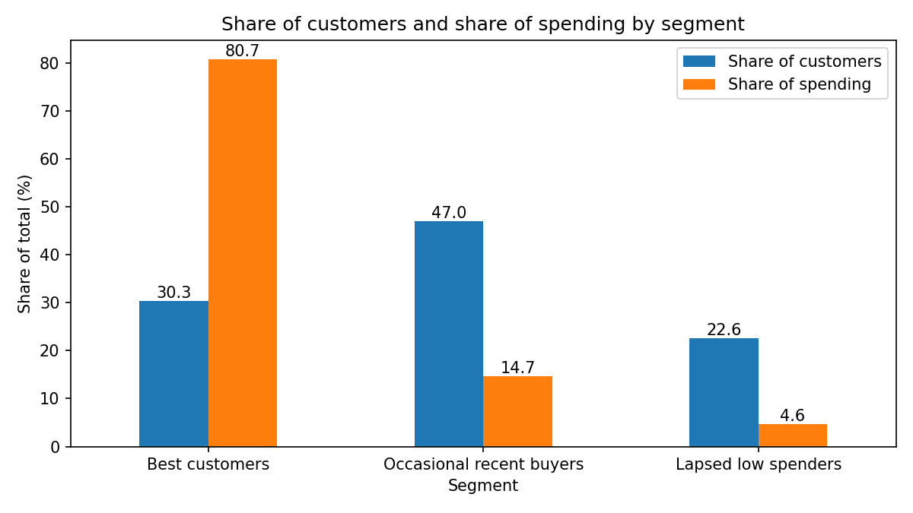
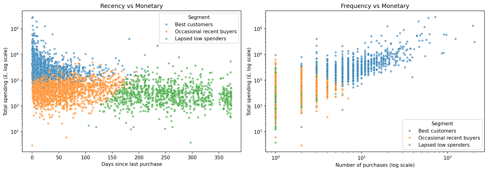
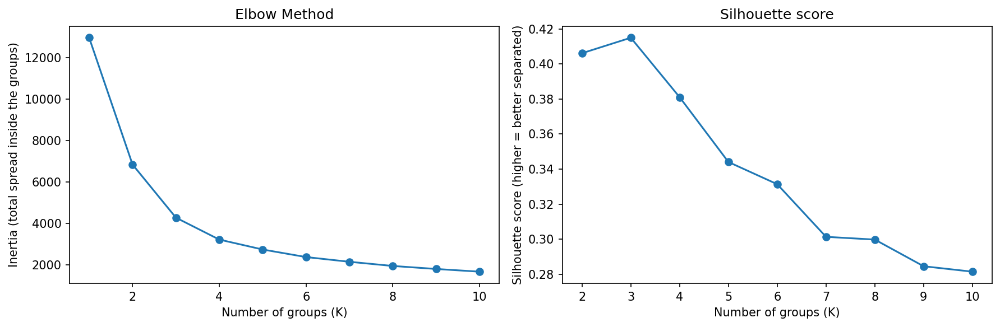

PROJECT 2
# CUSTOMER SEGMENTATION ANALYSIS (RFM and K-Means)

**In short:** the 4,320 customers of a UK online retailer fall into three segments. The 30.3% who are **Best customers** account for 80.7% of total spending, so protecting them matters most. 47.0% are **Occasional recent buyers**, who could be encouraged to buy again, and 22.6% are **Lapsed low spenders**, worth only a low-cost win-back.

## Business question
How can we group the customers of an online store by how recently, how often, and how much they buy, so that marketing can treat each group differently?

## Dataset
[Online Retail](https://archive.ics.uci.edu/dataset/352/online+retail) from the UCI Machine Learning Repository: 541,909 invoice lines from a UK online retailer, 1 December 2010 to 9 December 2011. The data file is not included in this repository.

## How customers are described (RFM)
- **Recency:** days from the customer's last purchase to the end of the data
- **Frequency:** number of different purchase invoices
- **Monetary:** total spending, purchases minus cancellations

## Segments

| Segment | Customers | Share of spending | Typical customer (median) |
|---|---|---|---|
| Best customers | 1,310 (30.3%) | 80.7% | last bought 17 days before the end of the data, 7 purchases, £2,476 |
| Occasional recent buyers | 2,032 (47.0%) | 14.7% | 45 days, 2 purchases, £499 |
| Lapsed low spenders | 978 (22.6%) | 4.6% | 252 days, 1 purchase, £271 |

## Recommended actions

| Segment | Action |
|---|---|
| Best customers | Loyalty programme or early access, starting with the 58 who have not bought for 106 days or more |
| Occasional recent buyers | Encourage a second and third purchase: a follow-up offer after a purchase, or recommendations based on what they bought |
| Lapsed low spenders | Low-cost win-back only, such as a single email |

## Key decisions
- **Cancellations are subtracted from each customer's spending.** A cancelled order is not spending: one customer's 80,995-unit order was cancelled 12 minutes later. Ignoring cancellations instead changes the segment of only 21 customers (99.5% stay).
- **Rows with no customer ID are left out** (14.7% of product sales value), as are postage, fees, and other service entries. The cleaned data holds 399,659 of the 541,909 rows.
- **Frequency and Monetary are log-transformed** before clustering, because both are very stretched, and then standardized. The number of groups (3) comes from the Elbow Method and the silhouette score (0.415).

## Limitations
- The segments overlap (silhouette score 0.415), so they describe tendencies, not sharp boundaries. Leaving Frequency out changes the segment of 9.4% of customers.
- The data covers one year, so it cannot show whether customers will return.

## How to run
1. Download `Online Retail.xlsx` from the link above and place it next to the notebook.
2. Install the packages: `pip install pandas numpy scikit-learn scipy matplotlib seaborn openpyxl jupyter`
3. Open `Shahd_Task2.ipynb` and run all cells (loading the Excel file takes about a minute).

## Tech stack
Python, pandas, NumPy, scikit-learn, matplotlib, seaborn, Jupyter Notebook.
