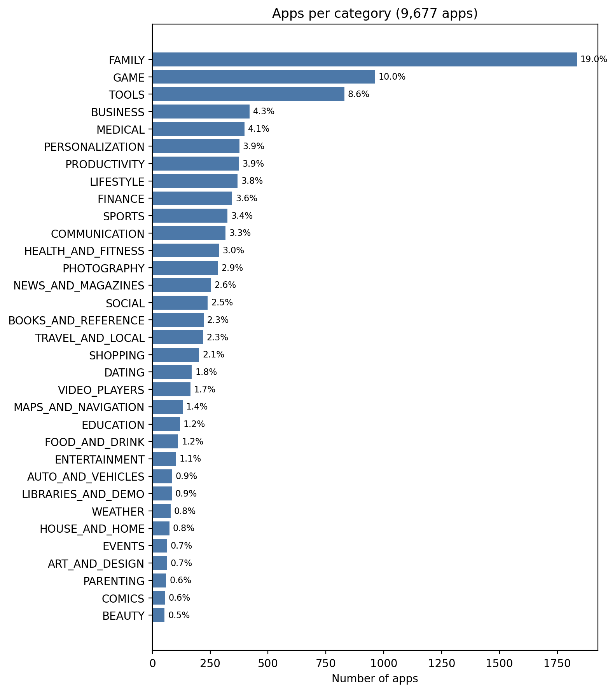
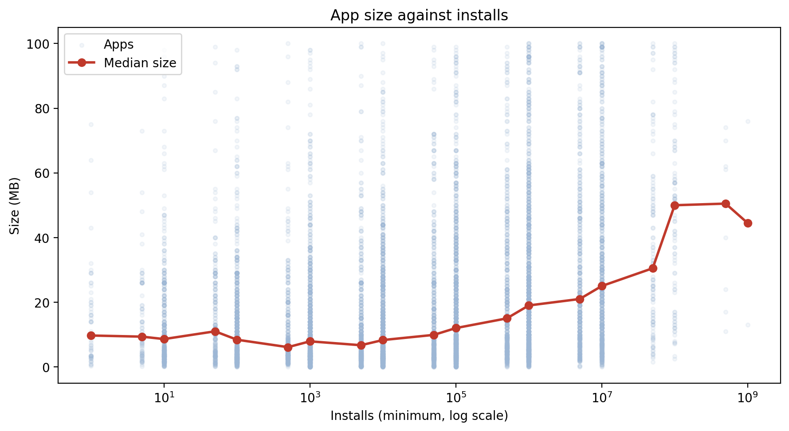
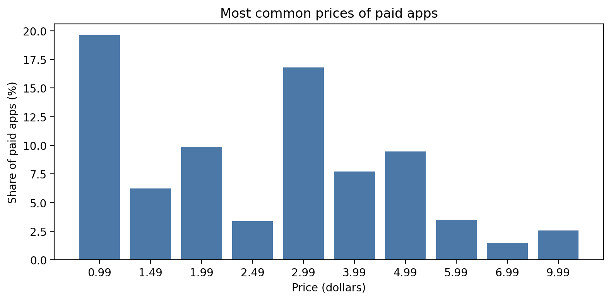

# Unveiling the Android App Market: Google Play Store Analysis

**Business question:** Which categories, price choices and app features give a new app the best chance of success?

## Key findings
1. **Category:** Education is the strongest all-round choice: 60.5% of its apps have 1,000,000+ installs, its rating is 4.36 and 78.1% of its reviews are positive (VADER). Crowding is a poor guide: Medical has 399 apps and 4.8% with big audiences, Entertainment has 102 apps and 84.3%.
2. **Price:** Paid is a small, hit-driven market. 7.8% of apps are paid, a typical paid app has 1,000 installs against 100,000 for free, and 7 apps hold 52.2% of the minimum revenue estimate. Most paid apps cost under 5 dollars (median 2.99).
3. **Quality:** 76.7% of rated apps have 4.0 or more. App size shows no link with popularity until 100,000+ installs (median size 6 to 12 MB up to 50,000 installs).

## Data
Google Play Store Apps (Kaggle): an apps file (10,841 rows) and a user reviews file (64,295 rows). The data is one snapshot, the newest update is 8 August 2018.

## What I did
- **Cleaned the apps:** converted text columns (Installs, Size, Price, Reviews, Last Updated) to numbers and dates, removed 1 invalid row, 483 exact copies and 680 repeated listings of the same app, leaving 9,677 apps. This changed results: before removing repeats, the minimum revenue estimate was 388.6 million, afterwards 291.1 million.
- **Flagged 17 extreme-price apps** ("I am rich" style, 299.99 or more) and reported price and revenue with and without them.
- **Cleaned the reviews:** 64,295 rows down to 29,692 (empty rows and identical rows removed).
- **Analysed:** categories, ratings, size against installs, free against paid, price and a minimum revenue estimate by category.
- **Sentiment:** scored reviews with VADER and compared with the labels in the file (76.5% agreement), reporting which findings hold with both.
- **Interactive chart (plotly):** crowding, audience and rating by category. Download `category_chart.html` and open it in a browser to hover over the dots.

## Charts

## Limitations
- A 2018 snapshot, with no trends.
- Installs are minimum groups, so the revenue estimate is a minimum.
- Reviews cover only 8.4% of apps, and those are much more popular than the rest.
- No app ID: repeated apps were matched by name and review count (10% cut-off).
- Sentiment tools disagree on 23.5% of reviews, and there are no hand-made labels.

## How to run
1. Download the two CSV files from Kaggle (Google Play Store Apps) and put them next to the notebook.
2. Install: `pip install pandas numpy matplotlib seaborn plotly vaderSentiment`
3. Open `Shahd_Task4.ipynb` and run all cells.

## Files
- `Shahd_Task4.ipynb`: the analysis
- `images/`: charts used in this README
- `category_chart.html`: interactive chart
