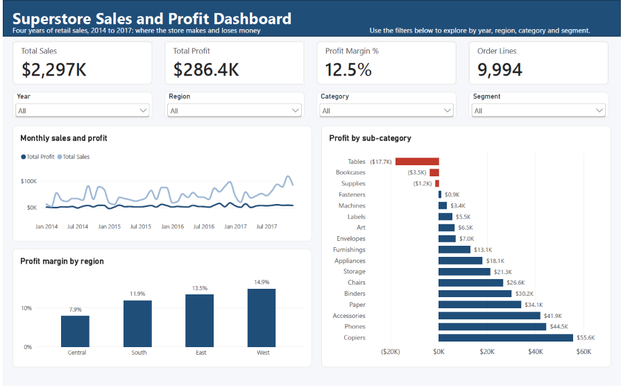
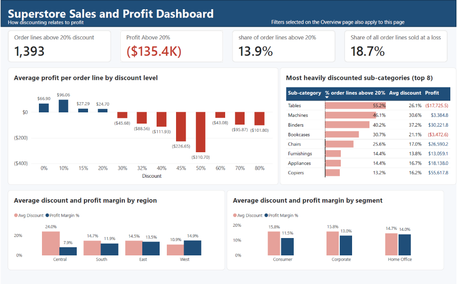

# Superstore Sales Analysis
PROJECT 1: Exploratory Data Analysis on Retail Sales Data

**Author:** Shahd Elhassan

> **In short:** I analysed four years of Superstore sales (9,994 rows) to find where the store makes and loses money. Items sold with a discount above 20% lost about 135K, almost half of the 286K total profit. The weakest areas are Tables, Bookcases, Machines, and the Central region.

## Business Question
Which products, categories, regions, and customer segments contribute most and least to profit, and how does discounting relate to their performance?

## Dataset
Sample Superstore dataset from Kaggle: [vivek468/superstore-dataset-final](https://www.kaggle.com/datasets/vivek468/superstore-dataset-final)
- 9,994 rows (each row is one product line within an order), covering 5,009 orders and 793 customers
- Orders from January 2014 to December 2017
- 21 columns: order and shipping details, customer segment, region, product category, sales, quantity, discount, and profit

The dataset has no age or gender, so customers are analysed by segment (Consumer, Corporate, Home Office).

**Definitions:** an "item sold" is one row of the dataset. Profit margin is profit divided by sales, which shows how much of each dollar sold is kept as profit.

## Key Findings
1. **Discounts above 20% are linked to losses.** Items sold at a discount of 20% or less make a profit on average, and from 30% upward the average is negative at every level. The 1,393 items sold above 20% lost about 135K, while the rest earned about 422K. The link holds for the same products: those sold at both levels earn about 85 per item at up to 20% and lose about 92 per item above 20%, which suggests discounting is a major driver of the losses.
2. **Furniture sells a lot but keeps little.** Its profit margin is about 2.5%, against about 17% for Technology and Office Supplies. Within it, the Tables sub-category (about -17.7K) and the Bookcases sub-category (about -3.5K) lose money, and the Machines sub-category sold about 189K but earned only about 3.4K.
3. **The Central region is the weakest.** Its profit margin is 7.9% (West: 14.9%), it gives the biggest average discount (about 24% against about 11% in the West), and about 1 in 3 of its items sold loses money.
4. **Best sellers are not always the best earners.** Only four of the ten products with the highest sales are also among the ten most profitable, and two of them (the Cisco TelePresence and the GBC DocuBind P400) are among the ten biggest loss-makers.
5. **Customer segments perform similarly.** Consumer is the largest segment and brings the most profit (about 134K), but profit margins are close across the three segments (11.5% to 14.0%).
6. **Sales grew about 51% from 2014 to 2017, and the last quarter is the strongest in every year.** It brings about 38% of each year's sales and about 39% of profit over the four years, although its share of profit varies from year to year.

## Key Charts

## Power BI Dashboard

The findings above come from the notebook. This interactive two-page dashboard presents the same data with filters for year, region, category and segment, applied to both pages.

**Where to look**
- **Overview:** KPI cards (total sales, total profit, profit margin, order lines), the monthly trend, profit by sub-category, and profit margin by region.
- **Discounts and profit:** KPI cards for order lines above a 20% discount (how many, their total profit in red, their share of all order lines) and for the share of all order lines sold at a loss; the discount chart; a table of the eight sub-categories with the most heavily discounted order lines; and discount against margin by region and by segment.

### What filtering revealed
These came from combining filters in the dashboard.
- **Central loses money in 7 sub-categories, against 3 for the whole store.** Appliances, Binders, Furnishings and Machines are profitable overall but lose money in Central. Its Technology margin (19.8%) is the highest of any region.
- **Furniture in Central is the only category and region combination with a negative margin (-1.8%).** 67.6% of its order lines carry a discount above 20%, against 4.7% in the West.
- **The share of order lines discounted above 20% barely moves by year:** 14.1%, 13.9%, 14.0% and 13.7% for 2014 to 2017.

### How it was built
- **Power Query:** imported the CSV, typed every column explicitly (dates read as US month/day/year), and profiled all 9,994 rows: no errors or blanks.
- **Model:** a flat sales table related one-to-many to a 2014 to 2017 date table on order date, with the date table marked as such.
- **DAX:** explicit measures for the KPIs and charts (total sales, total profit, profit margin, order lines, average discount, loss share, and the order lines, profit and share above a 20% discount). Profit margin is total profit divided by total sales, not an average of row margins. Order lines are a row count, not a count of orders, because one order has several lines.
- **Validation:** every KPI was reconciled to the Python results before any visual was built.

The `.pbix` file is not included, because it embeds a copy of the dataset, which is shared on Kaggle for educational use only.

## Recommendations
1. Test a 20% maximum discount, starting with Tables and Machines.
2. Lower discounts on Tables, Bookcases, and Machines. Tables may need a stricter limit.
3. Review discounting practice in the Central region.
4. Check the costs and prices of Supplies, which lose money without heavy discounting.
5. Protect the most profitable products, such as Copiers.
6. Plan stock and staff for the last quarter of the year, and watch its margin.

## Approach
Data inspection, and cleaning, descriptive statistics, time series, customer segments, product and category analysis, a correlation heatmap, and a profit analysis by category, region, and segment. The discount analysis checks whether the losses come from the discounts or from the products themselves.

## Limitations
- The data has no cost or stock information, so it shows where profit is lost but not always why.
- The discount comparisons do not control for region, date, or customer, so they show a link and do not prove cause. Recommendations should be tested on a small scale first.
- This is a sample dataset, so the results illustrate the method and do not describe a real company.

## Tools
Python, pandas, matplotlib, seaborn, Jupyter Notebook, Power BI (Power Query, DAX).

## Files
- `Shahd_Task1.ipynb`: the full analysis, with a written observation after each chart
- `images/`: charts used in this README

## How to Run
1. Download the dataset from [Kaggle](https://www.kaggle.com/datasets/vivek468/superstore-dataset-final) (the file is `Sample - Superstore.csv`; it is shared there for educational use) and put it in the same folder as the notebook.
2. Install the libraries: `pip install pandas matplotlib seaborn jupyter`
3. Open `Shahd_Task1.ipynb` in Jupyter and run all cells.

**Note:** the dataset is not UTF-8 encoded, so it is loaded with `encoding='latin-1'`. GitHub cannot preview the file, but it downloads and loads normally.
