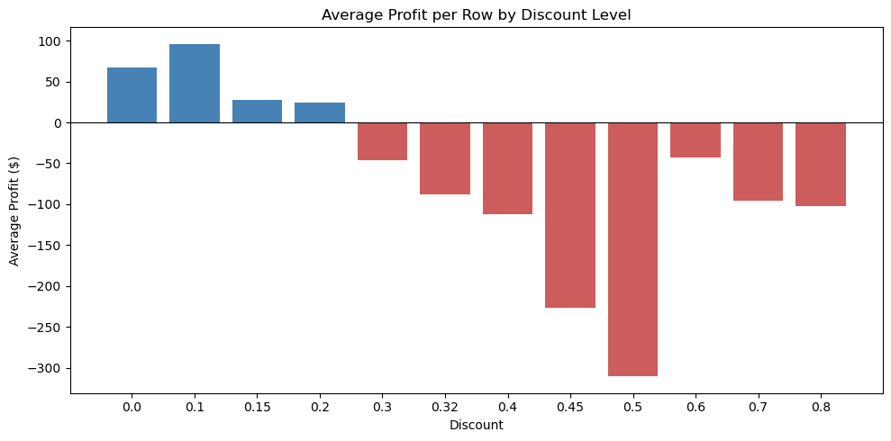
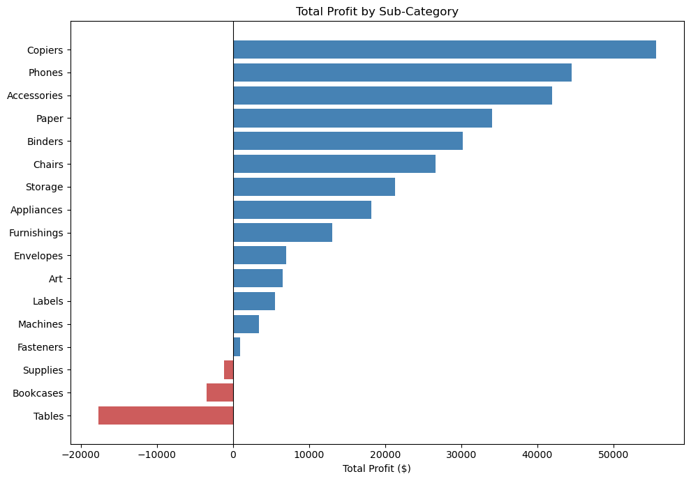

# Superstore Sales Analysis
*Oasis Infobyte Data Analytics Internship, Task 1: Exploratory Data Analysis on Retail Sales Data*

**Author:** Shahd

> **In short:** items sold with a discount above 20% lost about 135K, almost half of the store's 286K total profit. The weakest areas are Tables, Bookcases, Machines, and the Central region.

## Business Question
Which products, categories, regions, and customer segments contribute most and least to profit, and how does discounting relate to their performance?

## Dataset
Sample Superstore dataset from Kaggle: [vivek468/superstore-dataset-final](https://www.kaggle.com/datasets/vivek468/superstore-dataset-final)
- 9,994 rows (each row is one product line within an order), covering 5,009 orders and 793 customers
- Orders from January 2014 to December 2017
- 21 columns: order and shipping details, customer segment, region, product category, sales, quantity, discount, and profit

The dataset has no age or gender, so customers are analysed by segment (Consumer, Corporate, Home Office).

## Key Findings
1. **Discounts above 20% are linked to losses.** Items sold at a discount of 20% or less make a profit on average, and from 30% upward the average is negative at every level. The 1,393 items sold above 20% lost about 135K, while the rest earned about 422K.
2. **The link holds for the same products.** Products sold at both levels earn about 85 per item at up to 20% and lose about 92 per item above 20%, which suggests discounting is a major driver of the losses.
3. **Furniture sells a lot but keeps little.** Its profit margin is about 2.5%, against about 17% for Technology and Office Supplies. Tables (about -17.7K) and Bookcases (about -3.5K) lose money, and Machines sold about 189K but earned only about 3.4K.
4. **The Central region is the weakest.** Its profit margin is 7.9% (West: 14.9%), it gives the biggest average discount (about 24% against about 11% in the West), and about 1 in 3 of its items sold loses money.
5. **Best sellers are not always the best earners.** Two of the ten products with the highest sales are also among the ten biggest loss-makers. One product, the Canon imageCLASS 2200 copier, earns about 9% of all profit.
6. **Strong growth and clear seasonality.** Yearly sales grew about 51% from 2014 to 2017, and the last quarter brings about 38% of sales and about 39% of profit every year.

## Key Charts

## Recommendations
1. Test a 20% maximum discount, starting with Tables and Machines.
2. Lower discounts on Tables, Bookcases, and Machines. Tables may need a stricter limit.
3. Review discounting practice in the Central region.
4. Check the costs and prices of Supplies, which lose money without heavy discounting.
5. Protect the most profitable products, such as Copiers.
6. Plan stock and staff for the last quarter of the year.

## Approach
Data inspection and cleaning, descriptive statistics, time series, customer segments, product and category analysis, a correlation heatmap, and a profit analysis by category, region, and segment. The discount analysis checks whether the losses come from the discounts or from the products themselves.

## Limitations
- The data has no cost or stock information, so it shows where profit is lost but not always why.
- The discount comparisons do not control for region, date, or customer, so they show a link and do not prove cause. Recommendations should be tested on a small scale first.

## Tools
Python, pandas, NumPy, matplotlib, seaborn, Jupyter Notebook

## Files
- `Shahd_Task1.ipynb`: the full analysis, with a written observation after each chart
- `Sample - Superstore.csv`: the dataset
- `images/`: charts used in this README

## How to Run
1. Download this folder.
2. Install the libraries: `pip install pandas numpy matplotlib seaborn jupyter`
3. Open `Shahd_Task1.ipynb` in Jupyter and run all cells.

**Note:** the dataset is not UTF-8 encoded, so it is loaded with `encoding='latin-1'`. GitHub cannot preview the file, but it downloads and loads normally.
